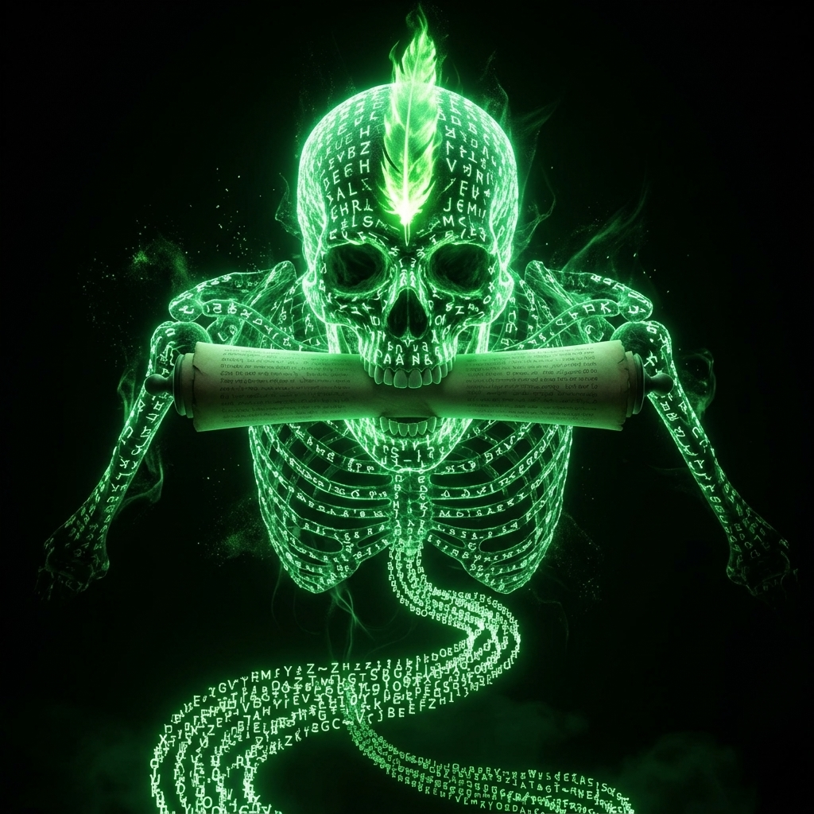

# Medaglione di Mr. Bones

*Non tutti gli oggetti vogliono essere trovati. Questo, a quanto pare, voleva essere ascoltato.*

Medaglione circolare legato al dio della morte. 4 cm di diametro, argento scuro ossidato, sospeso a una catena antica a maglia grezza. Oggetto unico al mondo. A prima vista si direbbe un simbolo sacro di Kelemvor o Myrkul.

Apparizione: catena di luce verde e lettere, uno scheletro con una piuma e una pergamena tra i denti.

## Le risposte di Kolì

Ad ogni apparizione ha posto una domanda e ha preso nota delle risposte di Kolì, concedendole ogni volta un nuovo incantesimo.

| Incantesimo sbloccato | Domanda e risposta |
|---|---|
| *False Life* (1°) | "Cosa rende una vita autentica?" — Perseguire sempre il proprio ideale più alto. |
| *Inflict Wounds* (1°) | "Quando il dolore diventa giustizia?" — Quando è utile al sommo bene di tutti. |
| *Speak with Dead* (3°) | "Quale traccia lascia una vita dopo la morte?" — L'anima. |
