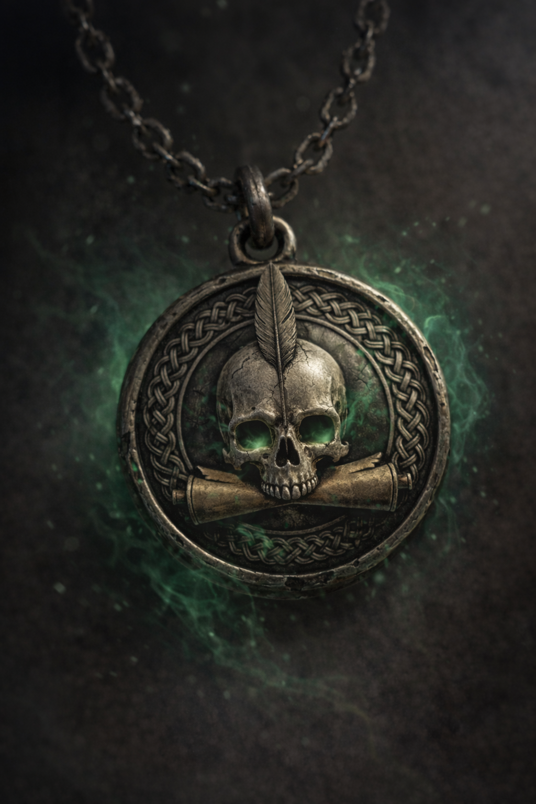

# Medaglione di Mr. Bones

*Non tutti gli oggetti vogliono essere trovati. Questo, a quanto pare, voleva essere ascoltato.*

Medaglione circolare legato al dio della morte. 4 cm di diametro, argento scuro ossidato, sospeso a una catena antica a maglia grezza. Oggetto unico al mondo. A prima vista si direbbe un simbolo sacro di Kelemvor o Myrkul.

## La voce nel medaglione

Chi lo indossa riceve, a volte, visioni: una catena di luce e lettere, poi una figura — uno scheletro bianco dalle sfumature verdi. Se interpellato sul nome, risponde sempre allo stesso modo:

> *"Puoi chiamarmi Mr. Bones."*

Alla prima apparizione, Mr. Bones chiama il portatore per nome e pone una domanda. La risposta data determina quale incantesimo il medaglione concede.

### Domande poste e risposte date

| Incantesimo assegnato | Domanda di Mr. Bones |
|---|---|
| *False Life* (1°) | "Cosa rende una vita autentica?" — Perseguire sempre il proprio ideale più alto. |
| *Inflict Wounds* (1°) | "Quando il dolore diventa giustizia?" — Quando è utile al sommo bene di tutti. |
| *Speak with Dead* (3°) | "Quale traccia lascia una vita dopo la morte?" — L'anima. |

## Uso dell'oggetto

Una volta per riposo lungo, chi è sintonizzato con il medaglione può lanciare l'incantesimo assegnato da Mr. Bones al livello minimo, senza componenti materiali.

## Scheda

| Campo | Valore |
|---|---|
| Tipo | Oggetto magico |
| Peso | — |
| Costo | 5.000 MO (stimato) |
| Reperibilità | unico al mondo |
| Richiede sintonia | ✓ |
| Effetti | Incantesimo assegnato da Mr. Bones (1/riposo lungo) |
