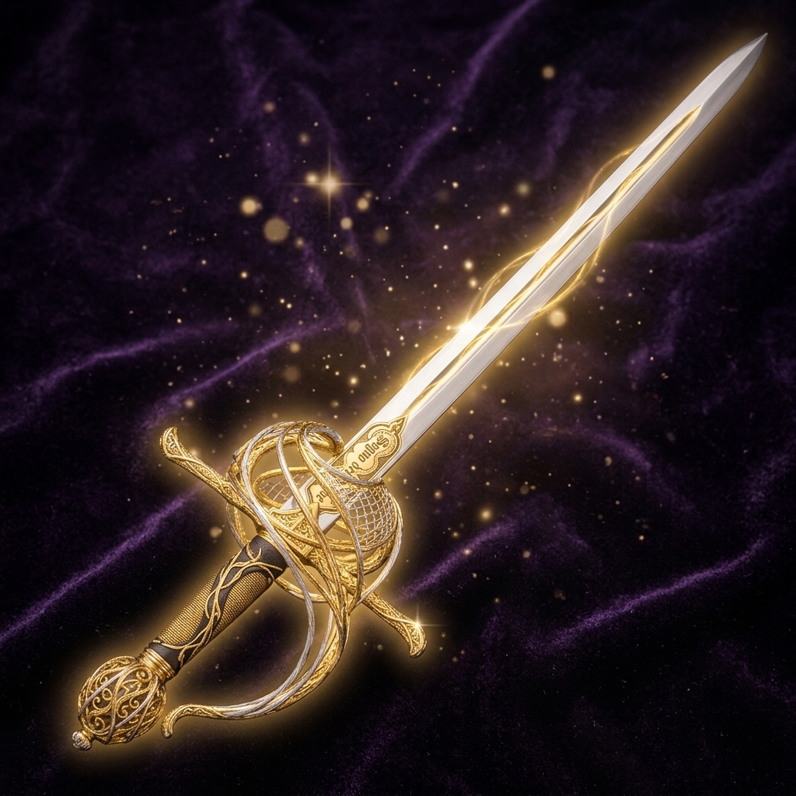

# Rapiere Segno del Verme

*Non tutte le lame portano un nome che si vorrebbe dimenticare.*

Rapiera leggermente incantata, con l'incisione "Segno del Verme", legata agli Zhentarim — "La maggior parte delle persone vede un covo di malattie nel comune ratto, gli Zhentarim vedono un potenziale collega".

## Azioni arma

Richiede competenza, impugnata in mano principale.

- **Piercing Strike** (Azione) — infligge una possibile Ferita Aperta. *Ricarica: riposo breve.*
	- Il personaggio sferra un affondo mirato a penetrare le protezioni del bersaglio. Se il tiro per colpire va a segno, l'attacco infligge i normali danni dell'arma e applica la condizione **Ferita Aperta** (Gaping Wound).
	- La creatura colpita subisce una lacerazione profonda. Ogni volta che il bersaglio viene colpito da un successivo attacco che infligge danni perforanti, subisce 1d4 danni perforanti aggiuntivi.
	- **Tiro salvezza:** Costituzione. **Durata:** 2 turni (oppure finché la creatura non riceve cure magiche).
- **Weakening Strike** (Azione) — attacco non letale alle mani del nemico, possibile Presa Debole. *Ricarica: riposo breve.*
	- Un attacco mirato alle mani, ai polsi o alle articolazioni superiori dell'avversario per comprometterne la capacità offensiva. In caso di colpo a segno, infligge i danni dell'arma e costringe la creatura a un **Tiro Salvezza su Costituzione**. In caso di fallimento, il bersaglio subisce la condizione **Presa Debole** (Weakened Grip): svantaggio ai tiri per colpire con la Forza e svantaggio alle prove di caratteristica e ai tiri salvezza su Forza.
	- Può essere dichiarato non letale, per neutralizzare o disarmare senza provocare la morte.
	- **Durata:** 2 turni.
- **Flourish** (Azione Bonus) — finta d'attacco, possibile Squilibrio. *Ricarica: riposo breve.*
	- Sfruttando un'Azione Bonus, il personaggio esegue una finta veloce o un virtuosismo per sbilanciare la guardia del nemico. Se l'attacco va a segno, infligge i danni dell'arma e il bersaglio deve effettuare un **Tiro Salvezza su Destrezza**. Se lo fallisce, subisce la condizione **Squilibrio** (Off-Balance): tutti i tiri per colpire contro di lui hanno vantaggio, e lui subisce svantaggio alle proprie prove di Forza e Destrezza.
	- **Durata:** 2 turni (o fino al termine del turno successivo del bersaglio).

## Note

Raccolta da Carl dopo lo scontro con gli Zhentarim, a Enebor.
