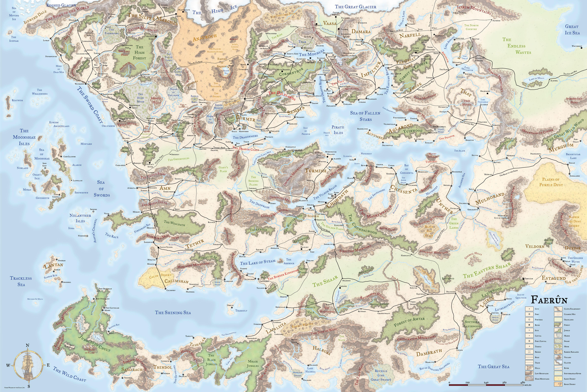

# Faerûn

Continente centrale di Toril, tra il Mare delle Spade a ovest e le terre di Kara-Tur a est. Dominato da regni umani, città-stato e confederazioni rurali, con enclave naniche ed elfiche sparse. Al centro si estende il Mare delle Stelle Cadute, che facilita i commerci tra le nazioni centrali.
