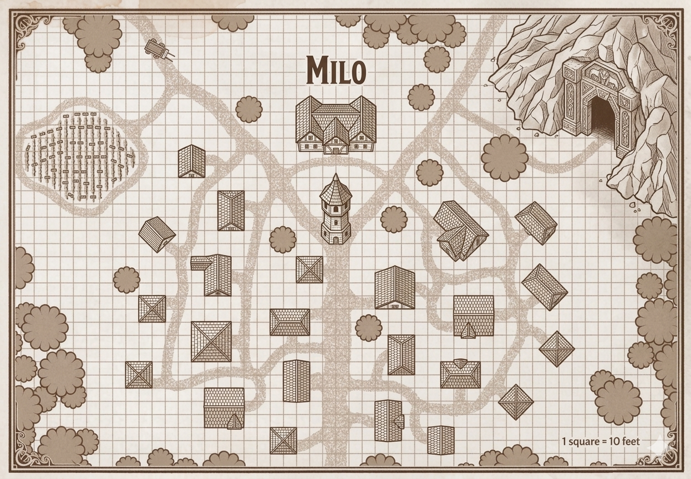
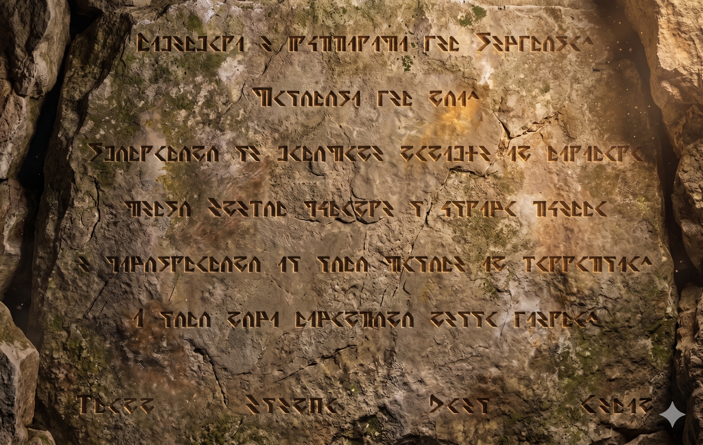

# 🗺️ Milo

*Villaggio nanico, non lo trovi per caso — e se arrivi, meglio che tu sappia aspettare: "la differenza tra un conoscente e un amico è circa un centinaio di anni."*

*Piccolo villaggio nanico alle pendici di Enebor, fondato cent'anni fa dai sopravvissuti alla guerra che li cacciò dalle montagne.*

---

## 🏘️ Descrizione

### Regione
Pendici meridionali delle Montagne di Enebor, sulle rive del Lago Milo — lago di origine sorgiva, alimentato da una falda acquifera profonda. Dal lago partono due fiumi: il Fiume Sesprosa verso nord e poi nordovest, fino a Semprosa; un corso senza nome verso sud, che scende fino a Marinella. Entrambi lenti, larghi o magri a seconda della stagione.

### Posizione
Sulle rive settentrionali del Lago Milo, dove il lago cede acqua al Fiume Sesprosa verso nord. Le montagne di Enebor si alzano alle spalle del villaggio, visibili ogni giorno — irraggiungibili per via dei banditi che infestano i passi. A due ore di cammino: terme naturali, frequentate di tanto in tanto dalla gente del villaggio.

### Popolazione
Quasi tutte famiglie naniche, discendenti dei clan che un tempo reggevano le montagne. Tra loro vivono anche due famiglie umane e una famiglia di elfling — accolte in epoche diverse, radicate nel tessuto del villaggio.

### Governo
Consiglio dei **Barbalunga** — gli anziani che ricordano ancora le sale perdute. Riunioni e decisioni si tengono nella caverna adiacente. Non c'è re: il titolo è vacante per scelta, come promessa non ancora tradita.

### Industria / Funzione
Estrazione di pietra dalle pendici basse, lavorazione del metallo presso la piccola forgia. Il commercio via fiume è l'unica via verso l'esterno, ma i banditi sui passi montani tagliano le rotte interne e impoveriscono gli scambi. Di tanto in tanto arrivano mercanti che vengono apposta: sanno che i nani di Milo producono manifattura di qualità e non hanno altri compratori. Pagano poco, rivendono altrove a prezzo pieno. I nani lo sanno, ma accettano — non hanno scelta.

### Reputazione
Quasi sconosciuto ai forestieri. Chi lo conosce lo descrive come un villaggio testardo — troppo piccolo per prosperare, troppo orgoglioso per spostarsi.

---

## 🏘️ Atmosfera

Poche case di pietra grigia addossate alla pendice, tetti di ardesia, nessun ornamento. Il fumo della forgia si vede da lontano prima che si vedano le case. Il lago è sempre presente — riflette le montagne, ricorda quello che c'era sopra.

Il silenzio qui ha il peso della pietra.

---

## 👥 Le famiglie forestiere

Non tutti a Milo sono nani. Tre famiglie vivono nel villaggio da generazioni, accolte con fatica e integrate lentamente nel tessuto della comunità.

### Le famiglie umane

Discendono da un ex guardia GATU che faceva da scorta a un nobile. Non gradiva i metodi usati dall'ATU contro i nani cento anni prima e si stabilì a Milo. I nani lo accettarono solo dopo anni — un centimetro di fiducia alla volta. I figli misero su famiglia e si divisero le occupazioni:

- **La famiglia della sorella** — agricoltura. Campi sulle pendici basse, cereali e verdure per il villaggio.
- **La famiglia del fratello** — pastorizia. Mandrie piccole, adatte al terreno aspro vicino alle montagne.

I genitori sono morti e riposano nel cimitero di Milo, unici forestieri in terra nanica.

### La famiglia elfling

Un'unica famiglia di Elfling — sangue misto di elfo e halfling — vive ai margini del villaggio. Portano attitudine alla magia e capacità inventiva che i nani tendono ad apprezzare più di quanto ammettano.

Gli elfling in antichità collaboravano con i nani. I dettagli di quella storia sono persi: né i vecchi nani né gli elfling stessi sanno ricostruirla per intero. Sanno solo che la cultura elfling è stata quasi del tutto cancellata, e che i suoi ultimi siti sopravvivono dispersi sull'isola di Sila. Il più noto è vicino a Marinella, villaggio peschereccio a sud dell'isola: Le Rovine di Selina.

A Marinella oggi vivono anche Torvak, Belma, Aeli e Lirin.

---

## ⛏️ La Caverna degli Anziani

Adiacente al villaggio, non sottoterra. Da fuori sembra piccola — un'apertura nella roccia, quasi anonima. Dentro è un'altra storia: ampliata nel corso di generazioni, ben rifinita, con pareti levigate e nicchie scolpite. I lavori di allargamento continuano ancora oggi, lentamente, come se i nani stessero costruendo qualcosa che non sanno ancora di cosa avrà bisogno.

Qui vivono gli anziani. Qui c'è la piccola forgia — funzionale, sufficiente. Qui si tengono le assemblee, i riti, le decisioni che contano. La vera forgia — quella grande, quella che il clan ricorda — è ancora nelle montagne, nelle sale occupate.

---

## 🎉 Tradizioni e riti

**Conforto Profondo** — 18° giorno del quinto mese, festa di Moradin. Gli anziani lo passano in meditazione nella caverna; i giovani festeggiano con birra e cibo attorno ai fuochi fuori.

**Festa della Luna** — in autunno, quando le notti si allungano. Si onorano i caduti della guerra e gli antenati. Ci si raduna, si raccontano storie, si innalzano preghiere. La ricorrenza più sentita dell'anno a Milo.

**Vittorie** — si celebrano con birre forti e armi nemiche esposte. Chi narra le proprie gesta deve essere accurato: la memoria nanica non tollera esagerazioni.

**Matrimoni** — sotto la protezione di Berronar Truesilver, dea del focolare. Si scambiano anelli d'argento o trattati con lucoreterno — un legame che non arrugginisce col tempo.

**Morti** — il nome del defunto viene scritto su pergamena e posto nella bocca prima della sepoltura in cripta di pietra. Il Canto Funebre dura più di 24 ore, solo in nanico, mai scritto — custodito da un unico bardo per generazione.

**Banchetti** — birra scura, stufati di radici e tuberi, funghi. Condividere una caraffa è un atto di fiducia. *"La differenza tra un conoscente e un amico è circa un centinaio di anni."*

---

## 🕯️ La Notte della Discesa

*26° giorno del primo mese — anniversario della caduta di Enebor (1900-01-26). La ricorrenza più importante di Milo.*

All'alba la forgia si spegne. È l'unico momento dell'anno in cui il fuoco della piccola forgia nella caverna degli anziani viene lasciato morire — un lutto di pietra e silenzio che dura tutta la giornata.

Al tramonto la comunità si raduna nella caverna davanti alla Galleria dei Valorosi.

**Il Canto della Discesa** — Il custode del Canto intona la versione di guerra: non i nomi dei morti, ma le loro azioni. Dura ore. Le voci si uniscono per i ritornelli, sempre in nanico, mai scritto.

**La Recita dei Nomi** — I Barbalunga leggono i nomi di ogni caduto documentato nella storia della Guerra di Enebor. Chi viene saltato è una vergogna per chi tiene il registro.

**Il Brindisi** — Birra scura, in piedi, davanti alle sculture: *"A coloro che sono caduti prima di noi. Torneremo nelle sale."*

**I Racconti** — I più anziani narrano le gesta dei valorosi. Ogni storia deve essere accurata: nessuna esagerazione è tollerata. Chi ingrandisce le imprese di un caduto lo disonora.

**La Riaccensione** — All'alba del giorno successivo il fuoco della forgia viene riacceso. Il primo colpo sul metallo caldo spetta all'anziano più vecchio.

---

### La Galleria dei Valorosi

Nella caverna degli anziani, su una parete scolpita nel corso delle generazioni, stanno le figure dei guerrieri che non tornarono — o che tornarono solo per testimoniare.

Le sculture principali:

- **Torvak** — lo Scudo di Enebor. In piedi, un braccio proteso come a coprire qualcosa. Chi lo ha visto dal vivo sa cosa.
- **Thorin** — comandante dell'ultima ritirata. Armatura pesante, sguardo verso le montagne.
- **Bromdir e Kaldun** — gli ultimi guardiani delle porte. Stanno affiancati, le spalle al muro.

Più in basso, su un pannello separato e ancora parzialmente incompiuto:

**I Forestieri Ricercati** — figure più piccole, scolpite diversamente dalle altre. I volti sono ben definiti, ogni tratto chiaramente leggibile nella pietra. Il resto della figura sfuma volutamente nel grezzo: spigoli taglienti, superficie irregolare, come se il corpo emergesse dalla roccia senza mai finire di nascere. Nessuno dei nani sopravvissuti seppe dire chi fossero: scortarono le carovane naniche in ritirata verso Enebor, poi scomparvero. I Barbalunga non le cancellano e non le finiscono: *"Non sappiamo chi erano. Ma erano là."* Vengono chiamati i Testimoni della Pietra.

> **Quote** — Iscrizione, Testimoni della Pietra
>
> 
>
> *Ricercati e fuggitivi per Semprosa. Valorosi per noi. Scortarono le carovane naniche in ritirata verso Enebor durante l ultima guerra e dimostrarono il loro valore in battaglia. I loro nomi rimangono nella pietra.*
>
> Brann · Elenya · Kael · Aerin

---

## 👥 PNG al volo

#### 1. ⚒️ Hargrin Slatebeard — Nano anziano · Consiglio dei Barbalunga

**Descrizione** — Barba bianca intrecciata con fili di ferro anneriti — un lutto che non si è mai sciolto. Mano destra con una vecchia bruciatura mai spiegata. Porta sempre un libro legato in pelle, chiuso da una cinghia.
**Voce** — Bassa, scandita, ogni parola pesata come se costasse qualcosa. Si interrompe a metà frase, come se ascoltasse qualcosa che nessun altro sente.
**Nome** — Hargrin Slatebeard · padre di Banteth · "il Custode dei Conti"

#### 2. 📜 Nor Stonewright — Nana anziana · Custode del Canto della Discesa

**Descrizione** — Minuta, quasi invisibile tra gli altri Barbalunga. Occhi chiarissimi, quasi bianchi. Mani incrociate sul petto quando ascolta.
**Voce** — Canta più che parlare, anche nelle frasi comuni — sillabe allungate, cadenza che si insinua nella memoria.
**Nome** — Nor Stonewright · "la Voce"

#### 3. 🪨 Yula Stonewright — Nana giovane · nipote di Nor

**Descrizione** — Spalle larghe, mani callose da chi lavora la pietra più che da chi canta. Capelli rasati sui lati, lunghi sopra — taglio che nessun altro a Milo porta.
**Voce** — Tagliente, frasi corte. Se si parla del Canto, cambia discorso con una battuta sulla pietra o sul tempo.
**Nome** — Yula Stonewright · "la Muta" (così la chiamano i più anziani, con disprezzo)

#### 4. 🔨 Brokk Ironvein — Nano adulto · fabbro della piccola forgia

**Descrizione** — Avambracci coperti di vecchie scottature ormai bianche. Un occhio chiuso per sempre da una scheggia di metallo, coperto da una benda di cuoio.
**Voce** — Roca, interrotta da colpi di tosse per il fumo della forgia.
**Risata** — Un singolo colpo di martello sul ferro: "Tang!"
**Nome** — Brokk Ironvein · "Mezzosguardo"

#### 5. 🌾 Edda Holdwin — Umana adulta · famiglia contadina

**Descrizione** — Robusta, mani sempre terrose fino al gomito. Cappello di paglia logoro che non si toglie nemmeno in casa.
**Voce** — Diretta, un po' brusca — si addolcisce subito se si parla di raccolti o di tempo.
**Nome** — Edda Holdwin · "la Sorella"

#### 6. 🐑 Cobb Holdwin — Umano adulto · pastore, fratello di Edda

**Descrizione** — Magro, zoppica leggermente (vecchio incidente con un montone). Porta sempre un bastone intagliato a forma di testa d'ariete.
**Voce** — Lenta, quasi assente — parla più alle bestie che alle persone, e si vede.
**Nome** — Cobb Holdwin · "il Fratello"

#### 7. 🌿 Sera Larkwhistle — Elfling adulta · famiglia elfling

**Descrizione** — Tratti misti elfo/halfling evidenti — orecchie leggermente a punta, statura bassa. Tasche piene di piccoli oggetti smontati e rimontati diversamente.
**Voce** — Veloce, entusiasta, salta da un argomento all'altro.
**Risata** — Un piccolo scoppio sorpreso, come se la facesse ridere anche lei: "Oh — ah!"
**Nome** — Sera Larkwhistle · "la Smontatrice"
